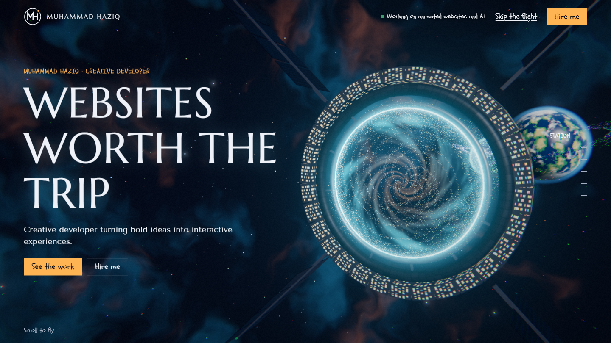
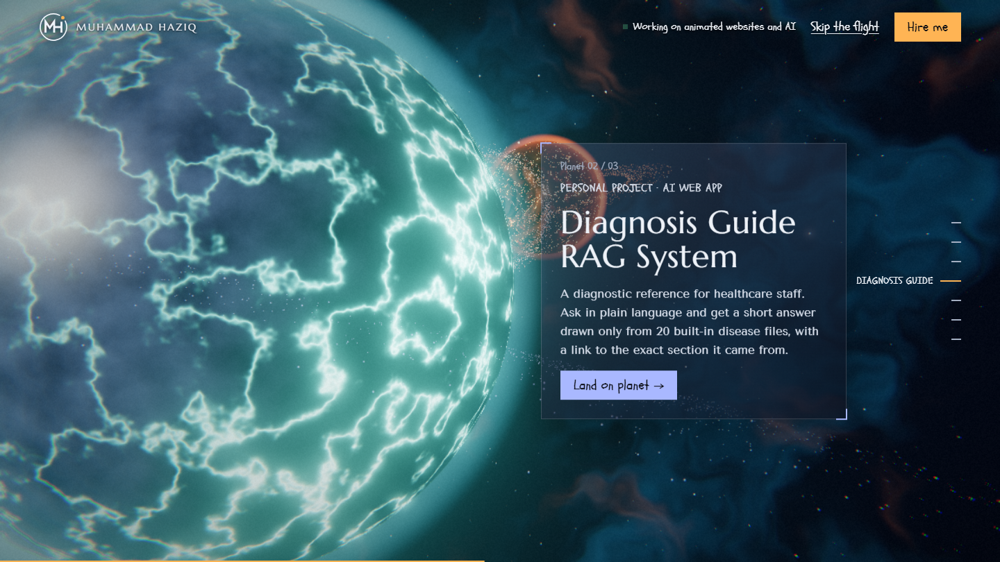
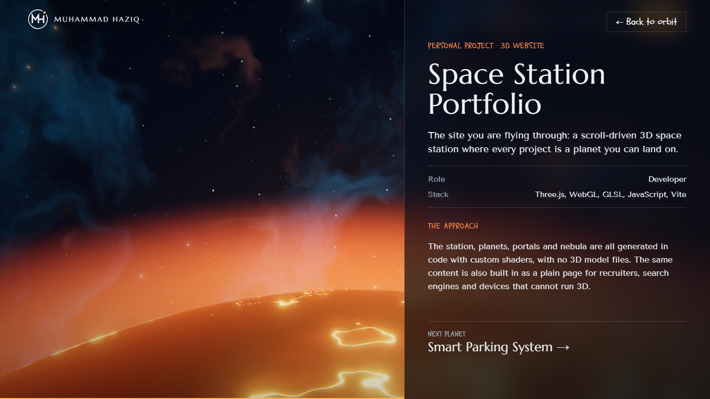
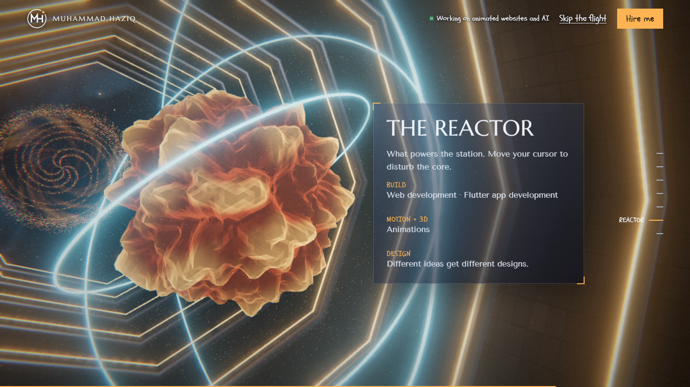
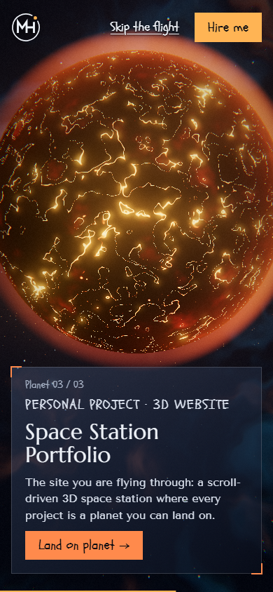

<div align="center">


# 3D Space Station Portfolio

**A scroll-driven WebGL portfolio. Scrolling flies a camera through a space station, and every project is a planet you can land on.**

Designed and built by [Muhammad Haziq](https://www.linkedin.com/in/muhammad-haziq-3351a0436/), creative developer.


</div>



## The flight

This is not a page that slides up. The page scroll drives a camera along a 3D route:

1. **The station.** Start outside a rotating ring station with a glowing particle portal.
2. **Pilot log.** Swing around the station to read about the developer.
3. **The portal.** Fly through the vortex and down a particle tunnel.
4. **The planets.** Visit each project in turn, passing through a particle gate between planets.
5. **Landing.** Choose "Land on planet" and the camera descends to the surface to open the case study.
6. **The Reactor.** Enter the engine hall, where the skills are listed and the core reacts to the cursor.
7. **Comms.** Finish at the contact screen.

| Planet in orbit | Landed on a planet |
|---|---|
|  |  |

| The Reactor | On a phone |
|---|---|
|  |  |

## Featured projects

| Planet | Project | What it is | Built with | Links |
|---|---|---|---|---|
| Ocean | **Smart Parking System** | A smart system for monitoring parking spaces and managing vehicle parking | Flutter, Android Studio, Firebase | [Source](https://github.com/pro-developer0/smart_parking_system) |
| Crystal | **Diagnosis Guide RAG System** | A diagnostic reference for healthcare staff that answers from 20 built-in disease files and cites its sources | Next.js, TypeScript, RAG, in-browser embeddings | [Live](https://diagnosis-guide-rag-system.vercel.app) · [Source](https://github.com/pro-developer0/diagnosis-guide-rag-system) |
| Lava | **Space Station Portfolio** | This website | Three.js, WebGL, GLSL, JavaScript, Vite | You are here |

## Highlights

- **Generated in code.** The station, planets, portals and nebula use procedural geometry and custom GLSL shaders, with no 3D model files.
- **Scroll-driven camera.** Native scrolling is mapped onto spline paths with parked stops, damping, banking and a speed-based field of view.
- **Real interface text.** Cards and case studies are HTML, so text stays selectable, keyboard-accessible and easy to read.
- **Shareable case studies.** Every project has its own link, such as `#/project/smart-parking-system`.
- **A plain version built in.** All content is written into the HTML at build time for search engines, link previews and "Skip the flight" visitors, who never download the 3D engine.
- **Accessible fallbacks.** Visitors with reduced motion turned on, or without WebGL 2, get the plain page automatically.
- **Adaptive performance.** Lower-powered devices get fewer particles, and resolution drops automatically if the frame rate falls.
- **Content in one file.** Adding a project to `src/content.js` rebuilds the route, planet and navigation.

## Controls

| Input | Action |
|---|---|
| Scroll or swipe | Fly along the route |
| <kbd>←</kbd> <kbd>→</kbd> | Jump to the previous or next stop |
| Side navigation | Go straight to a section |
| Click a parked planet | Land on it |
| <kbd>Esc</kbd> | Return to orbit |

## Run it locally

Requires [Node.js](https://nodejs.org) 20.19 or newer.

```bash
git clone https://github.com/pro-developer0/3D-portfolio-website.git
cd 3D-portfolio-website
npm install
npm run dev
```

On Windows PowerShell, use `npm.cmd` in place of `npm` if scripts are blocked.

| Command | Purpose |
|---|---|
| `npm run dev` | Start the development server |
| `npm run build` | Create the production site in `dist/` |
| `npm run preview` | Preview the production build locally |

## Make it yours

All of the site's text and links live in [`src/content.js`](src/content.js). A project entry looks like this:

```js
{
  slug: 'my-project',
  title: 'My Project',
  kicker: 'Client · Web app',
  summary: 'What it is, who it was for, and the result.',
  role: 'Developer',
  stack: ['React', 'Node'],
  repo: 'https://github.com/you/my-project',
  accent: '#7fe7ff',
  planet: { type: 'ocean', radius: 28, colors: ['#0b3a6e', '#3f8f5f', '#d6c28e'] },
}
```

`planet.type` can be `ocean`, `ember`, `gas` or `crystal`. Optional fields such as `live`, `duration`, `problem`, `approach` and `metrics` disappear from the page when left out.

## Project structure

```text
├── index.html            Page shell and plain-page detection
├── vite.config.js        Writes the plain page into the HTML at build time
├── public/               Favicon and résumé
└── src/
    ├── content.js        All site text, links and projects
    ├── render.js         HTML templates for case studies and the plain page
    ├── logo.js           The MH logo
    ├── style.css         Interface styles
    └── flight/
        ├── index.js      Renderer, post-processing and camera loop
        ├── layout.js     Camera route and scroll timeline
        ├── ui.js         Interface, navigation and panels
        ├── backdrop.js   Nebula, stars and speed streaks
        ├── station.js    The ring station
        ├── portal.js     Particle portals and tunnel
        ├── planet.js     Planet surfaces, atmospheres and rings
        └── reactor.js    The engine hall and core
```

## Deployment

This is a static site. On [Vercel](https://vercel.com), import the repository and use the **Vite** preset, with `npm run build` as the build command and `dist` as the output directory.

## Credits

- 3D rendering by [Three.js](https://threejs.org)
- 3D simplex noise by Ian McEwan and Ashima Arts
- Marcellus, Schoolbell and Tenor Sans, packaged by [Fontsource](https://fontsource.org)

## Contact

Open to freelance projects and collaborations.

**Muhammad Haziq** · [01muhammadhaziq@gmail.com](mailto:01muhammadhaziq@gmail.com) · [LinkedIn](https://www.linkedin.com/in/muhammad-haziq-3351a0436/) · [GitHub](https://github.com/pro-developer0) · [Instagram](https://www.instagram.com/meer_haziq.01/)
